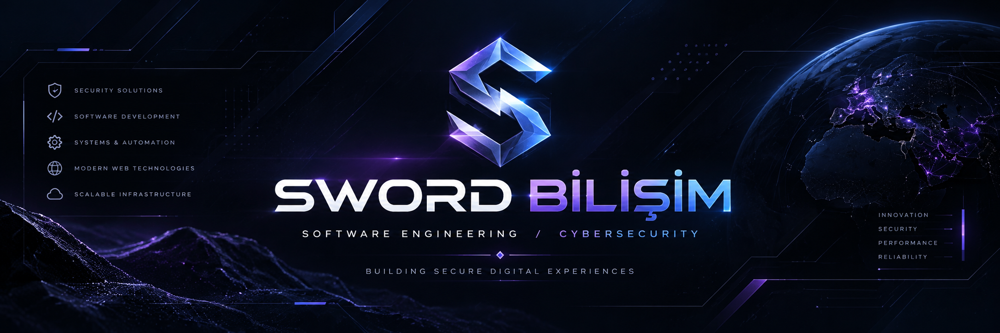
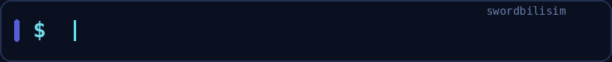
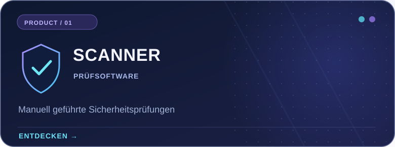
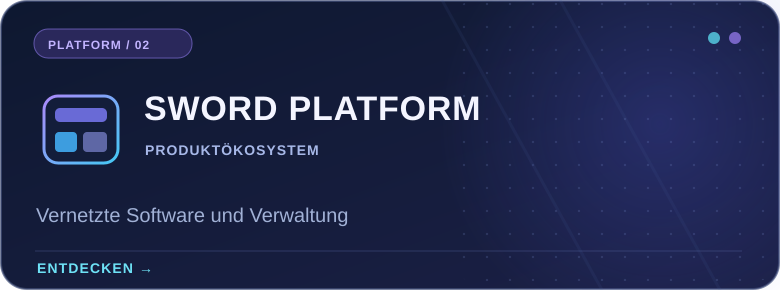
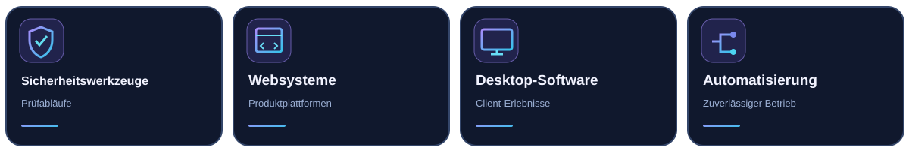

<!--
  Sword Bilişim — Premium Developer profile README
  Language: Deutsch
  Rendered by GitHub Flavored Markdown; language navigation uses regular links.
  Safe to edit. Do not remove ./assets paths unless files are moved.
-->

 

<b>LANGUAGE / DİL / SPRACHE / LANGUE / IDIOMA</b>
 
<a href="./README.md">🇬🇧 EN</a> &nbsp; · &nbsp; <a href="./README.tr.md">🇹🇷 TR</a> &nbsp; · &nbsp; <a href="./README.de.md">🇩🇪 <b>DE</b></a> &nbsp; · &nbsp; <a href="./README.fr.md">🇫🇷 FR</a> &nbsp; · &nbsp; <a href="./README.es.md">🇪🇸 ES</a>

  

<h3>Softwareentwicklung mit Sicherheit im Mittelpunkt.</h3>

Sword Bilişim entwickelt digitale Produkte, sicherheitsorientierte Werkzeuge und zuverlässige Softwarelösungen. Wir verbinden Produktdesign, Entwicklung und strukturierte Arbeitsabläufe.

## Auf einen Blick

Wir betrachten Software als Gesamtsystem: verständliche Oberflächen, wartbare Dienste, durchdachte Zugriffskontrollen und verlässliche Nutzererlebnisse.

## Ausgewählte Produkte

Produktinitiativen und ausgewählte Arbeiten. Einige Projekte werden privat entwickelt und sind nicht als öffentliche GitHub-Repositories verfügbar.

<table>
  <tr>
    <td width="50%" valign="top">
      
      
Eine von Menschen gesteuerte Prüfumgebung für autorisierte Prüfende, um relevante Systeminformationen bei selbst verwalteten Gameservern zu organisieren und zu bewerten. Kein automatisch sanktionierendes Anti-Cheat-System.

      
<a href="https://scanner.swordbilisim.com"><strong>Produkt entdecken →</strong></a>

    </td>
    <td width="50%" valign="top">
      
      
Die Plattforminitiative von Sword Bilişim verbindet Produkterlebnisse, Verwaltungsfunktionen und Dienste durch eine einheitliche Softwarearchitektur.

      
<a href="https://swordbilisim.com"><strong>Website besuchen →</strong></a>

    </td>
  </tr>
</table>

### Öffentlich auf GitHub

[**Steam-family-view-unlocker**](https://github.com/swordbilisim/Steam-family-view-unlocker) — Ein öffentliches Dienstprogramm-Repository dieses Kontos. Projektspezifische Informationen stehen im Repository.

## Unsere Schwerpunkte

Unsere Produktarbeit verbindet mehrere technische Disziplinen. Die Bereiche bedeuten nicht, dass jede Technologie in jedem Repository eingesetzt wird.

  

## GitHub-Aktivität

<b>Live-GitHub-Karten anzeigen</b>

 

Optionale Live-Karten von Drittanbietern. Sie können aufgrund von Dienstlimits ausfallen und zeigen nur auf GitHub sichtbare Aktivitäten.

## Kontakt & Links

Entdecken Sie unser Unternehmen, erfahren Sie mehr über Scanner oder besuchen Sie unsere öffentlichen Projekte.

**[Unternehmenswebsite](https://swordbilisim.com)** · **[Scanner-Produkt](https://scanner.swordbilisim.com)** · **[Öffentliche Repositories](https://github.com/swordbilisim?tab=repositories)**

<strong>Zuverlässige Software entwickeln. Mit einem klaren Ziel.</strong>
 
© Sword Bilişim · <a href="https://github.com/swordbilisim">@swordbilisim</a>

