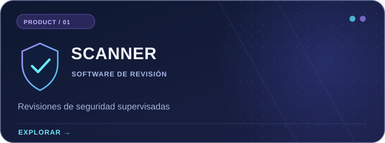
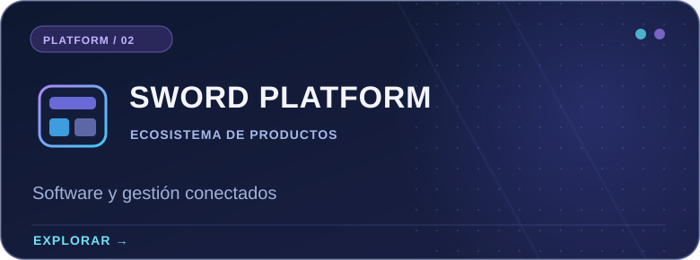
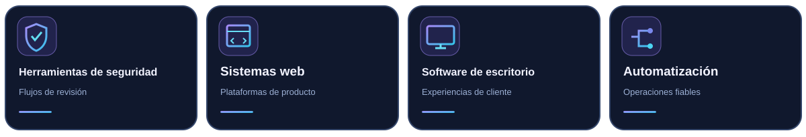

<!--
  Sword Bilişim — Premium Developer profile README
  Language: Español
  Rendered by GitHub Flavored Markdown; language navigation uses regular links.
  Safe to edit. Do not remove ./assets paths unless files are moved.
-->

 

<b>LANGUAGE / DİL / SPRACHE / LANGUE / IDIOMA</b>
 
<a href="./README.md">🇬🇧 EN</a> &nbsp; · &nbsp; <a href="./README.tr.md">🇹🇷 TR</a> &nbsp; · &nbsp; <a href="./README.de.md">🇩🇪 DE</a> &nbsp; · &nbsp; <a href="./README.fr.md">🇫🇷 FR</a> &nbsp; · &nbsp; <a href="./README.es.md">🇪🇸 <b>ES</b></a>

  

<h3>Ingeniería de software con la seguridad como prioridad.</h3>

Sword Bilişim desarrolla productos digitales, herramientas orientadas a la seguridad y experiencias de software fiables. Combinamos diseño de producto, ingeniería y flujos de trabajo estructurados.

## Vista general

Entendemos el software como un sistema completo: interfaces claras, servicios fáciles de mantener, controles de acceso adecuados y experiencias de usuario fiables.

## Productos destacados

Iniciativas de producto y trabajos seleccionados. Algunos proyectos se desarrollan de forma privada y no aparecen en repositorios públicos de GitHub.

<table>
  <tr>
    <td width="50%" valign="top">
      
      
Un entorno de revisión supervisado por personas que ayuda a revisores autorizados a organizar y evaluar información relevante del sistema en servidores de juegos administrados por comunidades. No es un sistema antitrampas automático.

      
<a href="https://scanner.swordbilisim.com"><strong>Explorar producto →</strong></a>

    </td>
    <td width="50%" valign="top">
      
      
La iniciativa de plataforma de Sword Bilişim reúne experiencias de producto, controles administrativos y servicios mediante una arquitectura de software coherente.

      
<a href="https://swordbilisim.com"><strong>Visitar sitio web →</strong></a>

    </td>
  </tr>
</table>

### Público en GitHub

[**Steam-family-view-unlocker**](https://github.com/swordbilisim/Steam-family-view-unlocker) — Un repositorio público de utilidades de esta cuenta. La información específica se encuentra en su propia página.

## Áreas de enfoque

Nuestro trabajo combina distintas disciplinas técnicas. Estas áreas no implican que todas las tecnologías se utilicen en cada repositorio.

  

## Actividad en GitHub

<b>Mostrar estadísticas de GitHub</b>

 

Tarjetas dinámicas opcionales de terceros. Pueden no estar disponibles por limitaciones del servicio y solo muestran actividad visible en GitHub.

## Enlaces y contacto

Conoce la empresa, descubre Scanner o explora nuestros proyectos públicos.

**[Sitio principal](https://swordbilisim.com)** · **[Producto Scanner](https://scanner.swordbilisim.com)** · **[Repositorios públicos](https://github.com/swordbilisim?tab=repositories)**

<strong>Diseñamos software fiable. Creamos con propósito.</strong>
 
© Sword Bilişim · <a href="https://github.com/swordbilisim">@swordbilisim</a>

