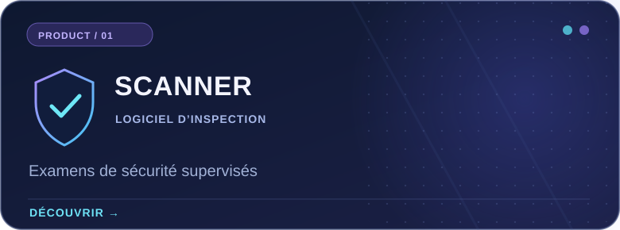
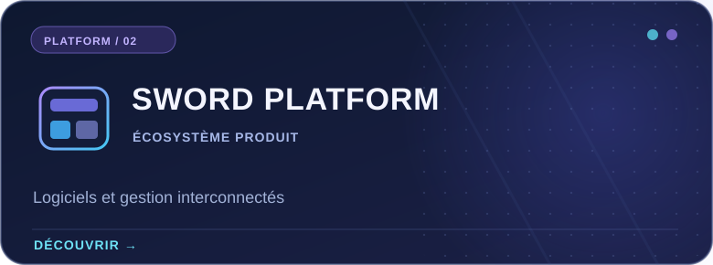
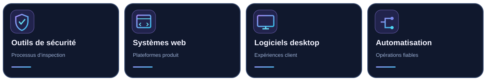

<!--
  Sword Bilişim — Premium Developer profile README
  Language: Français
  Rendered by GitHub Flavored Markdown; language navigation uses regular links.
  Safe to edit. Do not remove ./assets paths unless files are moved.
-->

 

<b>LANGUAGE / DİL / SPRACHE / LANGUE / IDIOMA</b>
 
<a href="./README.md">🇬🇧 EN</a> &nbsp; · &nbsp; <a href="./README.tr.md">🇹🇷 TR</a> &nbsp; · &nbsp; <a href="./README.de.md">🇩🇪 DE</a> &nbsp; · &nbsp; <a href="./README.fr.md">🇫🇷 <b>FR</b></a> &nbsp; · &nbsp; <a href="./README.es.md">🇪🇸 ES</a>

  

<h3>Une ingénierie logicielle pensée pour la sécurité.</h3>

Sword Bilişim conçoit des produits numériques, des outils orientés sécurité et des expériences logicielles fiables. Nous réunissons conception produit, ingénierie et processus structurés.

## En bref

Nous considérons le logiciel comme un ensemble cohérent : interfaces claires, services maintenables, contrôle des accès réfléchi et expérience utilisateur fiable.

## Produits à la une

Initiatives produit et réalisations sélectionnées. Certains projets sont développés en privé et ne figurent pas dans les dépôts GitHub publics.

<table>
  <tr>
    <td width="50%" valign="top">
      
      
Un espace d’inspection supervisé par des humains pour aider les examinateurs autorisés à organiser et évaluer des informations système pertinentes sur des serveurs de jeu communautaires. Ce n’est pas un système anti-triche automatique.

      
<a href="https://scanner.swordbilisim.com"><strong>Découvrir le produit →</strong></a>

    </td>
    <td width="50%" valign="top">
      
      
L’initiative de plateforme Sword Bilişim réunit expériences produit, fonctions d’administration et services au sein d’une architecture logicielle cohérente.

      
<a href="https://swordbilisim.com"><strong>Visiter le site →</strong></a>

    </td>
  </tr>
</table>

### Public sur GitHub

[**Steam-family-view-unlocker**](https://github.com/swordbilisim/Steam-family-view-unlocker) — Un dépôt public d’utilitaires de ce compte. Les informations spécifiques figurent sur sa page GitHub.

## Domaines d’activité

Nos travaux réunissent plusieurs disciplines techniques. Ces domaines ne signifient pas que chaque technologie est utilisée dans chaque dépôt.

  

## Activité GitHub

<b>Afficher les cartes GitHub</b>

 

Cartes dynamiques facultatives de services tiers. Elles peuvent être indisponibles et ne montrent que l’activité visible sur GitHub.

## Nous retrouver

Découvrez notre entreprise, explorez Scanner ou consultez nos travaux publics.

**[Site principal](https://swordbilisim.com)** · **[Produit Scanner](https://scanner.swordbilisim.com)** · **[Dépôts publics](https://github.com/swordbilisim?tab=repositories)**

<strong>Concevoir des logiciels fiables. Créer avec intention.</strong>
 
© Sword Bilişim · <a href="https://github.com/swordbilisim">@swordbilisim</a>

