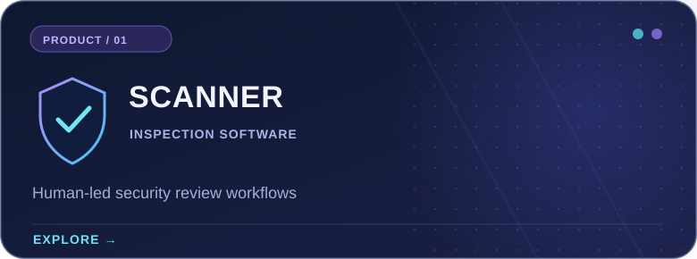
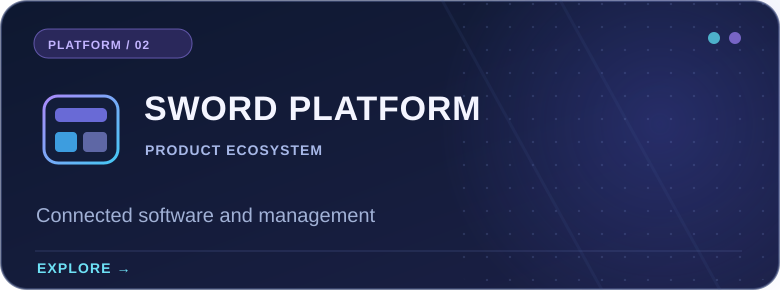
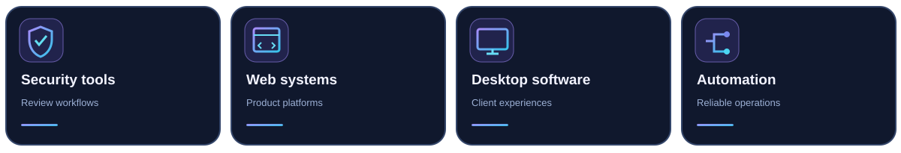

<!--
  Sword Bilişim — Premium Developer profile README
  Language: English
  Rendered by GitHub Flavored Markdown; language navigation uses regular links.
  Safe to edit. Do not remove ./assets paths unless files are moved.
-->

 

<b>LANGUAGE / DİL / SPRACHE / LANGUE / IDIOMA</b>
 
<a href="./README.md">🇬🇧 <b>EN</b></a> &nbsp; · &nbsp; <a href="./README.tr.md">🇹🇷 TR</a> &nbsp; · &nbsp; <a href="./README.de.md">🇩🇪 DE</a> &nbsp; · &nbsp; <a href="./README.fr.md">🇫🇷 FR</a> &nbsp; · &nbsp; <a href="./README.es.md">🇪🇸 ES</a>

  

<h3>Software engineered with security in mind.</h3>

Sword Bilişim builds digital products, security-oriented tools and reliable software experiences. We bring product design, engineering and structured workflows together.

## At a glance

We approach software as a complete system: clear product interfaces, maintainable services, thoughtful access controls and dependable user experiences.

## Featured products

Product initiatives and selected work. Some projects are developed privately and are not represented by public GitHub repositories.

<table>
  <tr>
    <td width="50%" valign="top">
      
      
A human-led inspection experience designed to help authorized reviewers organize and assess relevant system information for community-operated game servers. Not an automatic anti-cheat enforcement system.

      
<a href="https://scanner.swordbilisim.com"><strong>Explore product →</strong></a>

    </td>
    <td width="50%" valign="top">
      
      
The broader Sword Bilişim platform initiative, bringing together product experiences, administrative controls and services under a consistent software architecture.

      
<a href="https://swordbilisim.com"><strong>Visit website →</strong></a>

    </td>
  </tr>
</table>

### Public on GitHub

[**Steam-family-view-unlocker**](https://github.com/swordbilisim/Steam-family-view-unlocker) — A public utility repository from this account. Its repository page provides the project-specific information.

## Areas of focus

Our product work spans interconnected technical disciplines. These are focus areas, not a claim that every technology is used in every repository.

  

## GitHub activity

<b>Show live GitHub cards</b>

 

Optional live cards from third-party services. They may be unavailable due to service limits, and show only activity visible on GitHub.

## Connect with us

Explore the company, learn about Scanner or browse public work.

**[Main website](https://swordbilisim.com)** · **[Scanner product](https://scanner.swordbilisim.com)** · **[Public repositories](https://github.com/swordbilisim?tab=repositories)**

<strong>Designing reliable software. Building with purpose.</strong>
 
© Sword Bilişim · <a href="https://github.com/swordbilisim">@swordbilisim</a>

