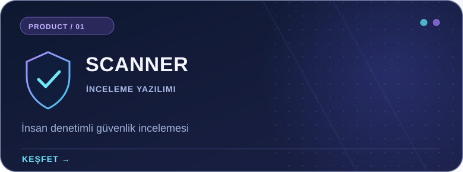
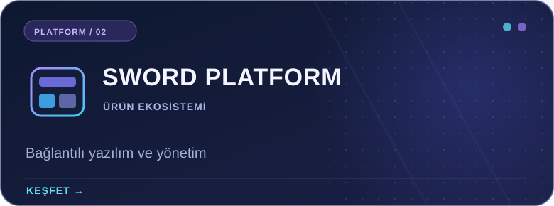
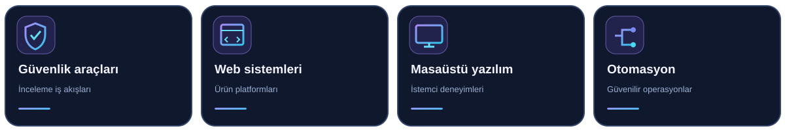

<!--
  Sword Bilişim — Premium Developer profile README
  Language: Türkçe
  Rendered by GitHub Flavored Markdown; language navigation uses regular links.
  Safe to edit. Do not remove ./assets paths unless files are moved.
-->

 

<b>LANGUAGE / DİL / SPRACHE / LANGUE / IDIOMA</b>
 
<a href="./README.md">🇬🇧 EN</a> &nbsp; · &nbsp; <a href="./README.tr.md">🇹🇷 <b>TR</b></a> &nbsp; · &nbsp; <a href="./README.de.md">🇩🇪 DE</a> &nbsp; · &nbsp; <a href="./README.fr.md">🇫🇷 FR</a> &nbsp; · &nbsp; <a href="./README.es.md">🇪🇸 ES</a>

  

<h3>Güvenliği odağına alan yazılım mühendisliği.</h3>

Sword Bilişim; dijital ürünler, güvenlik odaklı araçlar ve güvenilir yazılım deneyimleri geliştirir. Ürün tasarımı, mühendislik ve düzenli iş akışlarını bir araya getiriyoruz.

## Genel bakış

Yazılıma bütüncül bir sistem olarak yaklaşıyoruz: anlaşılır ürün arayüzleri, sürdürülebilir servisler, özenli yetkilendirme ve güvenilir kullanıcı deneyimleri.

## Öne çıkan ürünler

Ürün girişimleri ve seçili çalışmalar. Bazı projeler özel geliştirildiği için herkese açık GitHub depolarında yer almayabilir.

<table>
  <tr>
    <td width="50%" valign="top">
      
      
Topluluk sunucularında yetkili incelemecilerin ilgili sistem bilgilerini düzenleyip değerlendirmesini destekleyen, insan denetimli inceleme deneyimi. Otomatik yaptırım uygulayan bir anti-cheat sistemi değildir.

      
<a href="https://scanner.swordbilisim.com"><strong>Ürünü incele →</strong></a>

    </td>
    <td width="50%" valign="top">
      
      
Ürün deneyimlerini, yönetim kontrollerini ve hizmetleri tutarlı bir yazılım mimarisinde birleştirmeyi amaçlayan Sword Bilişim platform girişimi.

      
<a href="https://swordbilisim.com"><strong>Web sitesine git →</strong></a>

    </td>
  </tr>
</table>

### GitHub üzerinde açık

[**Steam-family-view-unlocker**](https://github.com/swordbilisim/Steam-family-view-unlocker) — Bu hesaba ait herkese açık bir yardımcı araç deposu. Projeye özel bilgiler deponun kendi sayfasında bulunur.

## Odak alanlarımız

Ürün geliştirme çalışmalarımız birbirini tamamlayan farklı teknik disiplinlere uzanır. Bu alanlar, her teknolojinin her depoda kullanıldığı anlamına gelmez.

  

## GitHub etkinliği

<b>Canlı GitHub kartlarını göster</b>

 

Üçüncü taraf servislerden isteğe bağlı canlı kartlar. Servis sınırlamaları nedeniyle görüntülenmeyebilir; yalnızca GitHub üzerinde görünen etkinliği yansıtır.

## Bağlantılar

Şirketimizi ve Scanner ürününü keşfedin veya herkese açık çalışmalarımıza göz atın.

**[Ana web sitesi](https://swordbilisim.com)** · **[Scanner ürünü](https://scanner.swordbilisim.com)** · **[Herkese açık depolar](https://github.com/swordbilisim?tab=repositories)**

<strong>Güvenilir yazılım tasarlıyoruz. Amacımızla üretiyoruz.</strong>
 
© Sword Bilişim · <a href="https://github.com/swordbilisim">@swordbilisim</a>

